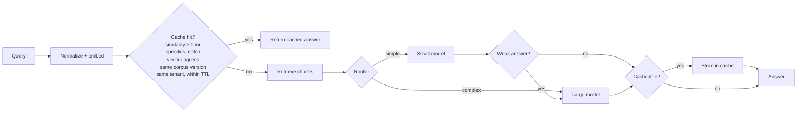

# Semantic caching and cost-aware routing for RAG

Cache answers by query similarity, send easy questions to a small model and hard ones to a large model, escalate when the small model's answer looks weak, and prove the savings on a dashboard.

> **Results:** _fill in after running the benchmark._
>
> | | Baseline (always large) | This system | Change |
> |---|---|---|---|
> | Cost per request | $ | $ | X% |
> | p95 latency | ms | ms | Y% |
> | Quality (keyword recall) | | | Δ |
> | Cache hit rate | n/a | % | |
>
> Measured on a Z-question eval set plus paraphrased repeat traffic.


## How a request flows



Every request, hit or miss, is logged to SQLite with model, tokens, cost, latency and (in benchmarks) a quality score.

## Design decisions

**Cache filters run inside the vector search.** Corpus version, tenant and TTL are Qdrant payload filters on the nearest-neighbor query, not checks applied afterward. Checking afterward means a stale entry that happens to be nearest would hide a valid entry just behind it.

**A guard catches what embeddings miss.** Embedding models score "refund after 30 days" and "refund after 14 days" as near-identical. Before serving a cached answer, the cache checks that numbers and acronyms (EU, US) don't conflict between the new query and the cached one, and falls through to the next candidate if they do.

**A verifier confirms cache hits.** Embedding models capture topic but not direction, so "cancel my subscription" and "restart my subscription" score as near-duplicates. With embeddings alone, a cache with zero false hits reused only about 10% of true paraphrases on the test set. The cache therefore works in two stages: embedding search finds candidates above a loose floor, then a verifier reads both questions together and makes the final call. A cross-encoder trained on Quora duplicate questions was tried first and failed on this domain (it rejected clear paraphrases and accepted opposites), so the verifier is a small LLM answering YES or NO. Its cost is logged on every request, including checks that end in a miss, so the savings figures stay honest.

**Re-ingesting invalidates the cache instantly.** `scripts/ingest.py` bumps `corpus_version`, and lookups only match the current version. The TTL is a second safety net.

**Personalized answers are tenant-scoped.** Pass `tenant_id` and entries are only visible to that tenant; shared answers use a shared namespace. This prevents one user's answer from being served to another.

**Only good answers get cached.** Errors, empty answers, "I don't know" and uncited answers are never stored, including answers that were still weak after escalation.

**The router sees retrieval scores.** Retrieval runs before routing, so the router can use how spread out the scores are. Flat, low scores suggest no single chunk answers the question and synthesis is needed.

**Escalation cost is counted honestly.** When a simple-routed query escalates, the logged cost includes both the wasted small-model call and the large-model call, and the escalation rate is tracked separately.

**Thresholds are chosen from data.** `tune_threshold.py` runs 50 paraphrase pairs and 50 near-miss pairs through both the embedding-only cache and the two-stage cache, and picks the most permissive settings with zero false hits.

## Quickstart

```bash
python -m venv .venv && source .venv/bin/activate
pip install -r requirements.txt
cp .env.example .env            # add API keys, then: export $(cat .env | xargs)
```

Edit `config.yaml`: set the small and large model names (any LiteLLM model string) and **fill in their prices per 1M tokens** from your provider's pricing page. Costs read as $0 until you do.

```bash
python scripts/ingest.py data/docs                          # index docs, bump corpus version
python scripts/tune_threshold.py data/threshold_pairs.jsonl # pick the cache threshold
python scripts/eval_router.py data/router_labels.jsonl --llm
python scripts/benchmark.py data/eval_set.jsonl --reset-cache
streamlit run dashboard/app.py
```

Serve the API with `uvicorn app.main:app --reload` and call it:

```bash
curl -X POST localhost:8000/ask -H 'content-type: application/json' \
     -d '{"query": "how do I reset my password"}'
```

Qdrant runs in local on-disk mode, which allows one process at a time. Stop the API before running the scripts, or point `config.yaml` at a Qdrant server.

Run the unit tests with `pytest`.

## Making the numbers credible

The files in `data/` are small starters that show the format. Before reporting results, grow them to roughly 50 paraphrase pairs plus 50 near-miss pairs for the threshold, 100 hand-labelled queries for the router, and a realistic eval set over your own documents. With small samples, "zero false hits" does not guarantee zero in production, so say so.

Quality is measured as keyword recall against expected keywords per question. It is cheap and deterministic but coarse; an LLM-as-judge score is a natural upgrade.

## Using your own RAG pipeline

`app/rag.py` holds a minimal retriever and generator. To plug in an existing pipeline, replace `retrieve()` and `generate()` and keep their return shapes: hits with a `score`, and results with `answer`, `sources`, `retrieval_scores`, `model`, token counts and `cost_usd`.

## Project layout

```
app/
  pipeline.py    request flow: cache, retrieve, route, generate, escalate, log
  cache.py       semantic cache with version, tenant and TTL filters
  router.py      rule-based router and an optional LLM classifier
  quality.py     escalation and cacheability checks, eval scoring
  rag.py         minimal retrieval and generation
  llm.py         LiteLLM wrapper with price-table cost
  db.py          SQLite request log and corpus version
  main.py        FastAPI app
scripts/         ingest, tune_threshold, eval_router, benchmark
dashboard/       Streamlit dashboard
data/            starter docs and eval files
tests/           unit tests for the pure logic
```

## License

MIT
